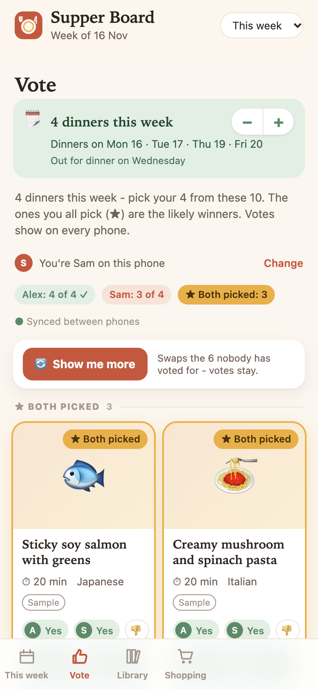
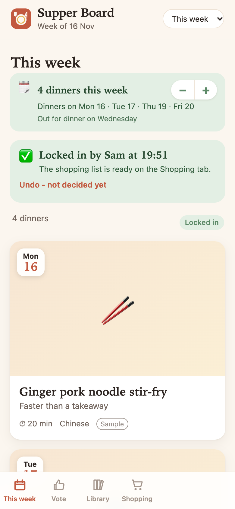
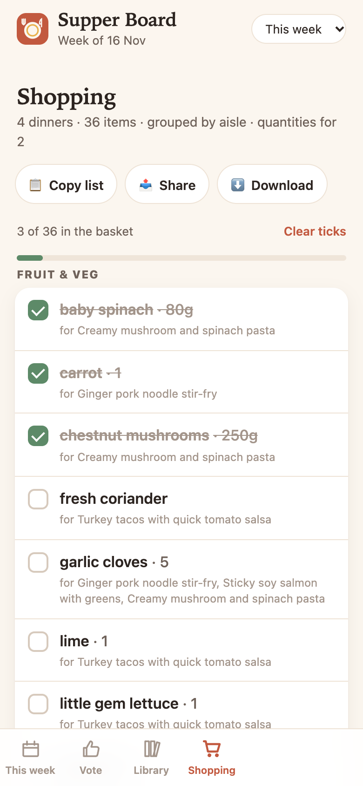
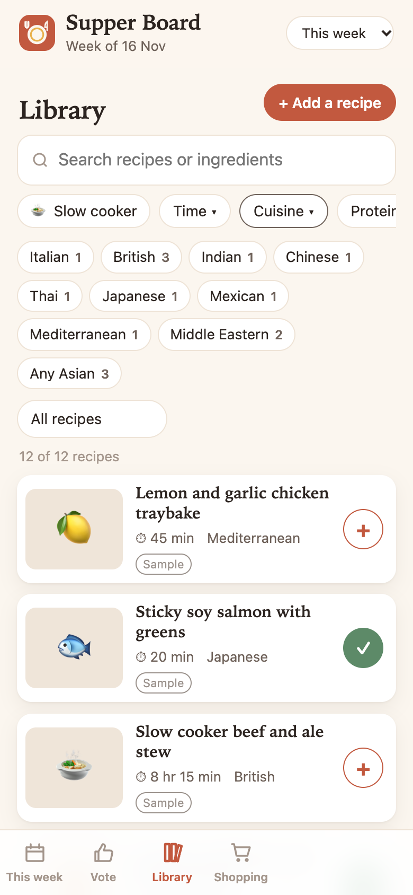
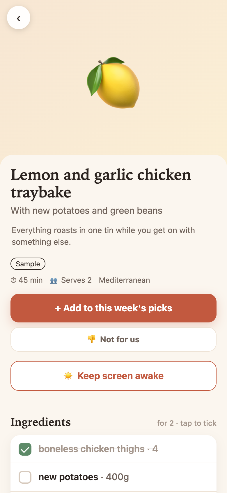
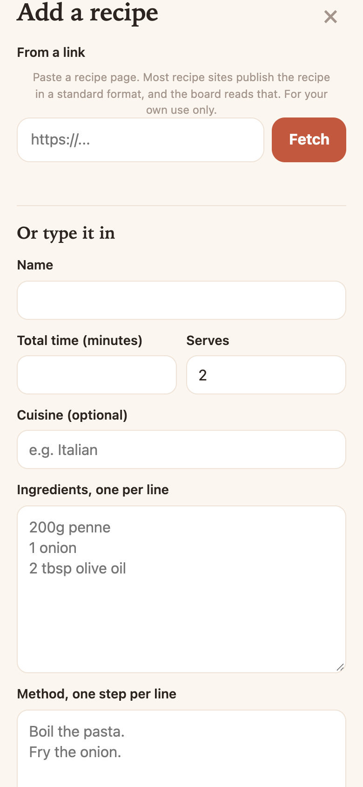

# Supper Board

**Forked from [weezerhunter/Supper-Board](https://github.com/weezerhunter/Supper-Board)** (MIT licence). The original is a shared kitchen board for a two-person household, built by talking to Claude. This version keeps that idea and the licence, and adds weekly voting, a searchable recipe library, recipe pages for Safari's cooking view, and a password-protected copy you can host for free on Cloudflare. Thank you to the original authors.

Supper Board is a small web app for deciding what's for dinner this week. Everyone in the house votes on a shortlist from your recipe library. The winners go on **This week**, each with a recipe you can cook from on your phone, and the ingredients turn into one **shopping list**.

It's free, it has no adverts or tracking, and you run your own copy. You don't need to be a developer. If you can follow a recipe, you can follow the [setup guide](docs/SETUP.md).

<p>
  
  
  
</p>

## What it does

- **Vote.** Each week the board offers a shortlist from your library (10 by default). Everyone picks as many as there are dinners that week. Recipes that everyone picked get a star and float to the top. Votes show on every phone within a few seconds.
- **Show me more.** Swaps every option nobody has voted for. Votes stay put.
- **Not for us 👎.** Takes a recipe off the list (unless someone else wants it) and stops it being suggested again. If someone keeps saying no to the same main ingredient or cuisine, it comes up less often.
- **Lock in these dinners.** Once everyone has picked, one tap puts the winners on **This week**, on the nights you're eating in.
- **How many dinners.** Change the number for the week with − and +, for example when you're out on Wednesday.
- **Library.** Search by name or ingredient ("spinach"), and filter by time, cuisine, main protein, type of dish and slow cooker. Recipes can sit in several categories at once.
- **Add a recipe.** Type one in, or paste a link to a recipe page and the board reads it for you (see below).
- **Recipe view.** Tick off ingredients and steps as you go, and keep the screen awake while you cook.
- **Safari's cooking view.** Every recipe has its own page with standard recipe data (schema.org), so Safari on Apple's HomeView can show it step by step.
- **Shopping list.** Built from the week's dinners, merged and grouped by aisle, with an "Also buy" list everyone can add to. Copy it, share it or download it, then take it to the shop or paste it into your online shop or AI agent.
- **Private.** A password you choose protects the whole board, and search engines are told not to index it.

<p>
  
  
  
</p>

## What you need

- A free [Cloudflare](https://dash.cloudflare.com/sign-up) account, to host it.
- A free [GitHub](https://github.com/signup) account, to keep your copy of the code.
- [Node.js](https://nodejs.org/) 18 or newer on your computer, to try it out and to publish it.
- Optional: an AI agent such as [OpenClaw](https://docs.openclaw.ai) or [Claude Code](https://docs.anthropic.com/en/docs/claude-code). The board works fine without one.

## Get started

The [setup guide](docs/SETUP.md) walks through everything step by step, with no assumed knowledge. The short version:

```sh
npm run dev
```

Then open http://localhost:8788 and sign in with `letmein` (that password only works on your own computer). When you're happy, follow the guide to put it online with your own password.

To set it up for your household, edit [`data/config.json`](data/config.json): your names, how many dinners a week, how many people you cook for, and any rules (for example, never suggest fish).

## Recipes

The board comes with 12 sample recipes, written for this project and free to use with the code. They're all for 2, with the method split into separate steps: some quick ones, a curry, a traybake, a pasta and a slow cooker stew. They have no photos, just an emoji on a coloured tile.

- **Start with no recipes:** set `"showSampleRecipes": false` in `data/config.json`.
- **Add your own on the board:** Library, then **+ Add a recipe**. Type it in, one ingredient per line and one step per line.
- **From a link:** paste the address of a recipe page and tap **Fetch**. Most recipe sites publish their recipes in a standard format (schema.org Recipe), and the board reads that. You check it over, then save. This is for your own personal use. The board fetches the one page you asked for, keeps a link back to the original, and doesn't copy photos. Respect each site's terms, and don't use it to republish other people's recipes.
- **In bulk, or with an AI agent:** see [Using it with an AI agent](docs/AI-AGENTS.md).
- **In the code:** add recipes to `data/recipes.json` (ingredient lines like `"200g penne"` are fine) and run `npm run sync`.

## Shopping

The Shopping tab builds one list from the week's dinners, scaled to the number of people in `config.json`. Things you'd normally already have (oil, salt, dried herbs, spice mixes) go in a "Cupboard - check you have it" section. Tick things off as you shop, or use **Copy list**, **Share** or **Download** to take it somewhere else.

The board doesn't connect to any shop. That's deliberate. It keeps the project simple and means nothing is ever bought without you.

### Optional: how one household does its online shop

You don't need any of this. Plenty of people just take the list to the supermarket.

If you use an AI agent that can work a web browser (OpenClaw can), you can ask it to do the online shop for you:

1. Give it your past orders once, so it learns your regulars: the milk, bread and bin bags you buy every week. Downloading or copying a few recent orders from your supermarket's website is enough.
2. Each week, tell it something like: *"Get this week's Supper Board shopping list, add our usual essentials, and fill my basket on the supermarket website. Don't check out. Show me the basket first."*
3. Check the basket yourself, change anything you like, and pay yourself.

Keep the last step in your own hands. Don't give an agent your card details or let it pay without you checking.

## Using it with an AI agent

An agent can read the week's votes, add recipes you send it (a link, a photo of a cookbook page, a recipe your friend messaged you), set the week ("we're away Thursday and Friday") and fetch the shopping list. It does this through a small command-line tool, `scripts/board.mjs`. See [docs/AI-AGENTS.md](docs/AI-AGENTS.md) for setup with OpenClaw, with Claude Code, or with no agent at all.

## Privacy

- The whole board, including the recipe pages and the API, sits behind your password. A correct password sets a cookie for a year, so each phone signs in once. Changing the password signs everyone out.
- Pages are marked `noindex`, so search engines don't list them.
- No analytics, no tracking, no fonts or scripts from other sites. The only outside requests are photos for recipes that have a photo link.
- Your votes, your own recipes and your "not for us" list live in a Cloudflare KV store in your own Cloudflare account.

## How it's built

No frameworks and no build step. Plain HTML, CSS and JavaScript, plus three small Cloudflare Pages Functions.

```
data/
  config.json           your settings: people, dinners per week, servings, rules
  recipes.json          the recipe library (the samples, plus any you add here)
site/                   the web app, published as-is
  index.html  app.js  styles.css
  shortlist.js          the rules for the weekly shortlist, and "is the week settled?"
  categories.js         recipe categories and search text
  shopping.js           ingredient parsing, aisles and the shopping list
  recipe-ld.js          schema.org Recipe data
  recipe-page.js        the /recipe/<id> pages
functions/
  _middleware.js        the password gate
  api/state.js          shared state: votes, the week, your recipes, "not for us"
  api/import.js         "Add a recipe from a link"
  recipe/[id].js        recipe pages for recipes added on the board
scripts/
  sync-site.mjs         builds site/data/ and the recipe pages from data/
  board.mjs             command-line tool (for you or an AI agent)
  check-site.mjs        end-to-end checks and the screenshots in docs/images/
```

Shared state is stored append-only, one log per device, so two phones voting at the same moment never overwrite each other.

## Checks

```sh
npm run dev                                                   # in one terminal
node scripts/check-site.mjs http://localhost:8788/ --password letmein   # in another
```

It signs in, tests the API (including 20 votes sent at the same moment), then drives headless Chrome through every tab and reports any errors. Add `--screenshot` to refresh the pictures in `docs/images/`. It needs Google Chrome installed.

## Licence

MIT, the same as the original. See [LICENSE](LICENSE). The sample recipes and screenshots are covered by the same licence.
