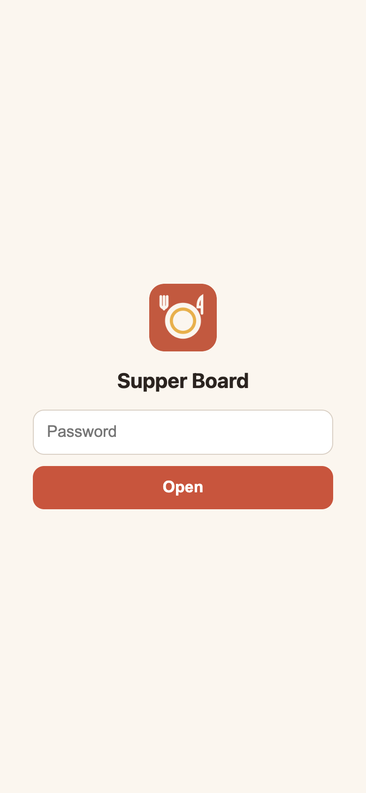
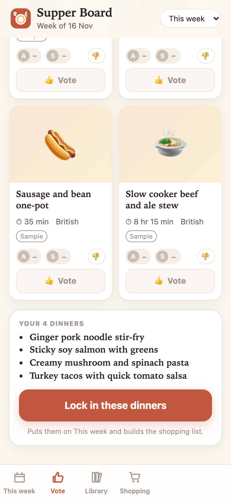
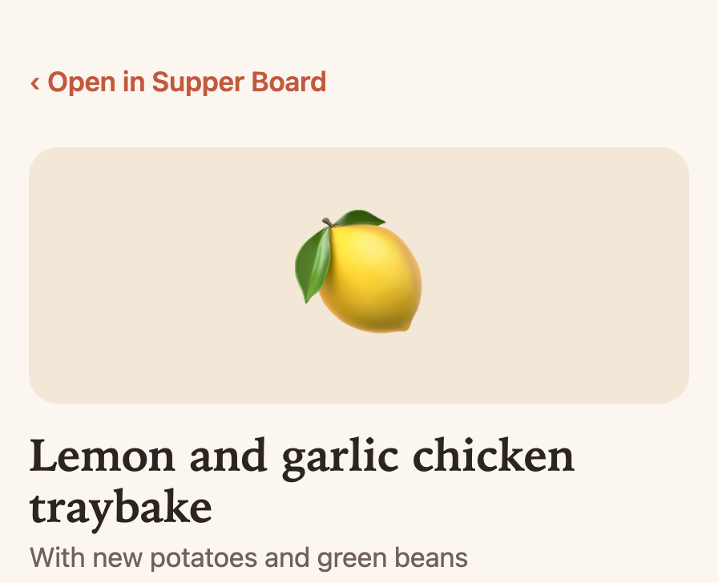

# Setting up Supper Board

This guide assumes no technical knowledge. It takes about 30 to 45 minutes the first time. Everything here is free.

By the end you'll have your own board at an address like `https://your-board.pages.dev`, protected by a password you choose, and an icon for it on everyone's phone.

If you get stuck, an AI agent is good at this kind of thing. Open the project folder in Claude Code or OpenClaw and say "help me follow docs/SETUP.md". See [AI-AGENTS.md](AI-AGENTS.md).

## Contents

1. [What you need](#1-what-you-need)
2. [Get your own copy of the code](#2-get-your-own-copy-of-the-code)
3. [Make it yours](#3-make-it-yours)
4. [Try it on your computer](#4-try-it-on-your-computer)
5. [Put it online with Cloudflare](#5-put-it-online-with-cloudflare)
6. [Add it to your phones](#6-add-it-to-your-phones)
7. [Everyday use](#7-everyday-use)
8. [Changing things later](#8-changing-things-later)
9. [If something goes wrong](#9-if-something-goes-wrong)

## 1. What you need

- **A computer** running macOS, Windows or Linux.
- **Node.js 18 or newer.** Download the "LTS" version from [nodejs.org](https://nodejs.org/) and install it like any other app. To check it worked, open a terminal (see below) and type `node --version`. You should see a number like `v22.11.0`.
- **A free GitHub account** at [github.com/signup](https://github.com/signup). GitHub keeps your copy of the code and tells Cloudflare when it changes.
- **A free Cloudflare account** at [dash.cloudflare.com/sign-up](https://dash.cloudflare.com/sign-up). Cloudflare hosts the board. The free plan is plenty for a household. You don't need to add a card.
- **Google Chrome**, only if you want to run the automatic checks.

**Opening a terminal.** On a Mac, press Cmd and Space, type `Terminal` and press Return. On Windows, open the Start menu and type `PowerShell`. A terminal is a window where you type commands and press Return to run them. In this guide, commands are shown in grey boxes like this:

```sh
node --version
```

## 2. Get your own copy of the code

The easiest way:

1. Sign in to GitHub and open this project's page.
2. Click **Fork** (top right), then **Create fork**. You now have your own copy at `github.com/<your-name>/supper-board`.
3. On your copy's page, click the green **Code** button, then **Download ZIP**. Unzip it somewhere easy to find, such as your Documents folder.

If you already use Git, you can `git clone` your fork instead.

Now open a terminal in that folder. On a Mac, type `cd ` (with a space after it), drag the folder from Finder into the Terminal window and press Return. On Windows, open the folder in File Explorer, click the address bar, type `powershell` and press Return.

## 3. Make it yours

Open `data/config.json` in any text editor (TextEdit on a Mac, Notepad on Windows). It looks like this:

```json
{
  "title": "Supper Board",
  "people": [
    { "id": "alex", "name": "Alex" },
    { "id": "sam", "name": "Sam" }
  ],
  "dinnersPerWeek": 4,
  "optionsPerWeek": 10,
  "servings": 2,
  "showSampleRecipes": true,
  "siteUrl": "",
  "rules": { "maxMinutes": null, "exclude": [], "maxSameProtein": 3, "maxSlowCooker": 2, "recentWeeks": 3 }
}
```

Change what you need:

| Setting | What it does |
|---|---|
| `title` | The name at the top of the board. |
| `people` | Everyone who votes. `name` is what the board shows. `id` is a short label in lower-case letters with no spaces, like `jo` or `grandad`. One person is fine, and so are up to eight. |
| `dinnersPerWeek` | How many dinners you usually plan. You can change it each week on the board. |
| `optionsPerWeek` | How many recipes go up for the vote each week. |
| `servings` | How many people you cook for. The shopping list scales each recipe to this. |
| `showSampleRecipes` | `false` hides the 12 sample recipes, so you start with an empty library. |
| `siteUrl` | Your board's address once it's online, for example `https://our-dinners.pages.dev`. Optional. |
| `rules.maxMinutes` | Never suggest anything that takes longer than this (slow cooker recipes don't count). `null` means no limit. |
| `rules.exclude` | Categories never to suggest, for example `["fish"]` or `["pork", "over-60"]`. The names are in `site/categories.js`. You can still add these by hand. |
| `rules.maxSameProtein` | At most this many chicken (or beef, and so on) recipes in one week's list. |
| `rules.recentWeeks` | Try not to suggest anything you've had in this many past weeks. |

Save the file. Keep the quote marks and commas exactly as they are. If the board won't start afterwards, a missing comma is the usual reason.

## 4. Try it on your computer

In the terminal, in the project folder, type:

```sh
npm run dev
```

The first time, it asks to install a Cloudflare tool called `wrangler`. Type `y` and press Return. After a few seconds you'll see `Ready on http://localhost:8788`.

Open **http://localhost:8788** in your browser. You'll see the sign-in page:



Type `letmein` and press **Open**. This password only exists on your computer. You'll choose a real one in the next step.

Have a look around. Pick who you are on the Vote tab, vote for a few dinners, and look at the Library and the Shopping tab. Anything you do here stays on your computer.

To stop it, go back to the terminal and press Ctrl and C.

## 5. Put it online with Cloudflare

There are two ways. **Option A** connects Cloudflare to your GitHub copy, so the board updates itself whenever you change the code on GitHub. **Option B** publishes straight from your computer. Pick one.

Cloudflare sometimes renames its menus. If something below isn't exactly where this guide says, look for the nearest match.

### Step 5.1: Create a storage space (both options)

The board keeps votes, your own recipes and the week's settings in a small store called KV.

1. Sign in at [dash.cloudflare.com](https://dash.cloudflare.com).
2. In the left-hand menu, open **Storage & Databases**, then **KV** (it may be under **Workers KV**).
3. Click **Create** (or **Create a namespace**). Name it `supper-board-state` and save.

### Option A: Connect your GitHub copy (recommended)

1. First, put your settings on GitHub. On your fork's page, open `data/config.json`, click the pencil icon, make the same changes as in step 3, and click **Commit changes**.
2. In Cloudflare, open **Workers & Pages** and click **Create** (or **Create application**).
3. Choose the **Pages** tab, then **Connect to Git** (or **Import an existing Git repository**).
4. Connect your GitHub account when asked, and choose your `supper-board` repository.
5. On the build settings screen, enter:
   - **Project name:** anything you like, for example `our-dinners`. This becomes your address: `our-dinners.pages.dev`.
   - **Production branch:** `main`
   - **Framework preset:** `None`
   - **Build command:** `node scripts/sync-site.mjs`
   - **Build output directory:** `site`
6. Click **Save and Deploy**. Wait for it to finish. It will say it's live, but the board won't work properly until the next two steps are done.

### Option B: Publish from your computer

1. In the terminal, in the project folder, type:

   ```sh
   npx wrangler login
   ```

   A browser window opens. Sign in to Cloudflare and click **Allow**.
2. Then type:

   ```sh
   npm run deploy
   ```

   The first time, it asks whether to create a new project. Say yes, give it a name (for example `our-dinners`) and use `main` as the production branch. If you chose a name other than `supper-board`, open `package.json` and change `--project-name supper-board` in the `deploy` line to your name first.

### Step 5.2: Connect the storage and set your password (both options)

1. In Cloudflare, open **Workers & Pages** and click your project.
2. Open **Settings**, then **Bindings** (on older screens: **Functions**, then **KV namespace bindings**).
3. Click **Add**, choose **KV namespace**, and enter:
   - **Variable name:** `STATE` (exactly that, in capitals)
   - **KV namespace:** `supper-board-state`
4. Save. If it asks about **Production** and **Preview**, add it to both.
5. Still in **Settings**, open **Variables and Secrets** (or **Environment variables**). Click **Add**:
   - **Type:** Secret (or tick **Encrypt**)
   - **Variable name:** `SITE_PASSWORD`
   - **Value:** the password everyone will use to open the board. Pick something you'll all remember but nobody would guess. Capital letters don't matter when you sign in.
6. Save.
7. Settings only take effect on the next deploy. With **Option A**, open **Deployments**, click the three dots next to the latest one and choose **Retry deployment**. With **Option B**, run `npm run deploy` again.

### Step 5.3: Check it

Open your board's address (for example `https://our-dinners.pages.dev`). You should see the sign-in page. Sign in with your new password. Under the Vote tab's tally it should say **Synced between phones**. If it says "Preview mode", the storage isn't connected yet: go back to step 5.2.

If you're comfortable with the terminal, you can also run the automatic checks against your live board. Use `--readonly` so it doesn't vote on anything:

```sh
node scripts/check-site.mjs https://our-dinners.pages.dev/ --password "your password" --readonly
```

## 6. Add it to your phones

Send the address and the password to everyone in the house.

- **iPhone:** open the address in Safari and sign in. Tap the Share button, then **Add to Home Screen**.
- **Android:** open it in Chrome and sign in. Tap the three dots, then **Add to Home screen** (or **Install app**).

It opens full-screen like an app. Each phone signs in once and stays signed in for a year.

The first time each person opens the Vote tab, the board asks who they are. That's remembered on their phone.

## 7. Everyday use

A typical week:

1. **Early in the week, everyone votes.** Open the Vote tab and tap 👍 on the dinners you fancy, up to the week's number. Use − and + on the green card if you're eating in more or fewer nights. Tap **Show me more** if nothing appeals.
2. **Lock in.** When everyone has picked and there's no tie, a **Lock in these dinners** button appears at the bottom of the Vote tab and on This week.

   
3. **Shop.** Open Shopping. Tick things off in the shop, or tap **Copy list** and paste it into your supermarket's website, a note, or your AI agent.
4. **Cook.** Open the dinner from This week. Tap **Keep screen awake**, tick off ingredients and steps as you go.

On an Apple HomeView, or any iPad, open a recipe and tap **Recipe page (for Safari's cooking view on HomeView)**. Safari can then show it one step at a time.



## 8. Changing things later

- **Settings:** edit `data/config.json`. With Option A, edit it on GitHub and Cloudflare updates the board in a minute or two. With Option B, edit it on your computer and run `npm run deploy`.
- **Recipes:** add them on the board (Library, then **+ Add a recipe**). They're saved straight away, with no deploying needed.
- **Password:** change `SITE_PASSWORD` in Cloudflare (step 5.2), then redeploy. Everyone will need to sign in again with the new one.
- **Your own address:** in your Cloudflare project, open **Custom domains** to use a domain you own. Then put it in `siteUrl` in `config.json`.
- **Getting updates to the code:** on your fork's GitHub page, click **Sync fork** when GitHub says there are new changes.

## 9. If something goes wrong

| What you see | What to do |
|---|---|
| "Site password not configured" | The `SITE_PASSWORD` secret is missing. Do step 5.2, then redeploy. |
| "Preview mode (no /api here)" or "KV binding STATE missing" | The storage isn't connected. Check the binding is called `STATE` exactly, then redeploy. |
| Votes don't appear on the other phone | Wait 20 seconds, or close and reopen the app. Cloudflare can take up to a minute to share a change between its locations. |
| "No recipe data found on that page" when adding from a link | That site doesn't publish its recipes in the standard format, or blocks automatic reading. Type the recipe in instead. |
| `npm run dev` says `command not found: npm` | Node.js isn't installed, or the terminal was open before you installed it. Install Node.js and open a new terminal. |
| The board shows "Couldn't load the board" after editing `config.json` | Usually a missing comma or quote mark. Compare your file with the example in step 3. |
| Build fails on Cloudflare | Check the build command is `node scripts/sync-site.mjs` and the output directory is `site`. |
